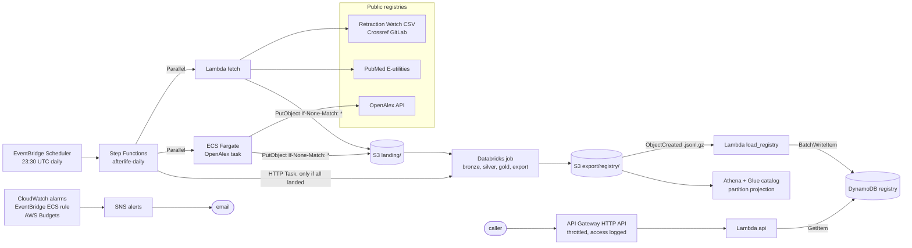

# afterlife on AWS

AWS runs the two ends of the pipeline. **Ingest:** scheduled fetchers land raw
source bytes in an immutable S3 landing zone. **Serving:** the registry export
becomes a DynamoDB table behind a public HTTP API that answers "is this DOI,
PMID, PMCID, or OpenAlex id retracted, and according to whom?". Spark
(Databricks) and dbt build everything in between.

**Nothing here has touched a real AWS account.** There is no account or
credential on the machine this was built on. Everything was checked locally:
the handlers against moto, the Terraform with `validate`, `terraform test`
against a mock provider, and checkov. See [Verification](#verification) for
what was run and what was not.

## Architecture



One KMS customer managed key encrypts the bucket, the table, both queues,
every log group, the SNS topic, the ECR repository, and Athena results.

| Path | What | Code |
|---|---|---|
| `aws/lambdas/fetch/handler.py` | Lands the newest Retraction Watch snapshot or today's PubMed result; OpenAlex on demand | thin adapter over `afterlife.sources` |
| `aws/container/Dockerfile` | The OpenAlex fetch as a Fargate task: `python -m afterlife.cli fetch openalex` | stdlib core plus boto3 |
| `aws/lambdas/load_registry/handler.py` | Export to DynamoDB, one item per identifier alias | validates everything before the first write |
| `aws/lambdas/api/handler.py` | `GET /v1/lookup/{id+}`, `GET /v1/coverage`, `GET /health` | never answers "ok" for a lookup |
| `aws/build.py` | Byte for byte reproducible Lambda zips | stdlib `zipfile` |
| `aws/terraform/` | Root module and `modules/{landing,ingest,serving,analytics,ci,observability}` | AWS provider 5.x, Terraform >= 1.6 |
| `tests/test_aws.py` | 19 moto tests for the handlers and the zip builder | `pytest -m aws` |
| `aws/terraform/tests/stack.tftest.hcl` | 5 `terraform test` runs against a mock provider | `terraform test` |

## Every service, and why it is here

| Service | Role | Why this one |
|---|---|---|
| S3 | Landing zone, exports, Athena results | The landing zone is the system of record (ADR 0002). S3 conditional writes (`If-None-Match: *`) make "never overwrite a landed snapshot" a property of the store, not of the code's good behaviour. Versioning keeps a deleted object recoverable for `noncurrent_version_days`. |
| Lambda | Retraction Watch and PubMed fetches, export loader, API | Two short runs a day, one load a day, and bursty API traffic: idle cost is zero. The core is stdlib only, so each zip is about 30 KB with no layers. arm64 because nothing native is bundled. |
| ECS Fargate | OpenAlex fetch | Runs past Lambda's 15 minute ceiling. See below. |
| ECR | OpenAlex image | Immutable tags, scan on push, KMS encrypted, ten images retained. |
| EventBridge Scheduler | Daily trigger | Time zone aware cron, per target retry policy and DLQ, KMS for target input. Replaces the older CloudWatch Events cron rule. |
| Step Functions | `afterlife-daily` orchestration | Parallel fetches with per branch catch, so one source failing does not discard the others' results, then a Choice that starts Databricks only when every source landed. The HTTP Task calls the Databricks Jobs API with no Lambda in between. |
| EventBridge connection | Databricks credentials | The HTTP Task authenticates through a connection whose token EventBridge keeps in a Secrets Manager secret it manages. |
| Secrets Manager | OpenAlex API key (optional) | The value is put with the CLI, never in Terraform, so it never enters state. ECS injects it into the container; the Lambda reads it once per execution environment. |
| SQS | Dead letter queues | One for ingest (Scheduler and the fetch Lambda), one for serving (the loader). A message there means retries are exhausted, and an alarm says so. |
| DynamoDB | The serving registry | Every lookup is one key read. On demand billing, PITR, deletion protection, TTL, CMK encryption. |
| API Gateway HTTP API | Public API | Cheaper and simpler than a REST API for a Lambda proxy; stage throttling (burst and rate), built in CORS, JSON access logs. |
| Glue Data Catalog + Athena | SQL over exports | Partition projection on `as_of`, so no crawler and no `MSCK REPAIR`. The workgroup enforces its settings and cancels any query scanning more than `athena_bytes_scanned_cutoff` (1 GiB default). |
| KMS | One customer managed key | A key policy is an access control independent of IAM, every decrypt is a CloudTrail event, and disabling one key makes all project data unreadable. Rotation on. S3 bucket keys cut per object KMS calls. |
| CloudWatch | Logs, metrics, alarms | JSON Lambda logs, X-Ray tracing on functions and the state machine, alarms listed below. |
| SNS | Alert fan out | One topic, KMS encrypted, email subscription. |
| AWS Budgets | Cost guardrail | Monthly budget, alerts at 80% actual and 100% forecast. |
| IAM OIDC | GitHub Actions deploys | No stored keys. The trust policy matches `repo:TanayPratapSingh/afterlife:ref:refs/heads/main` exactly. |

### Why the OpenAlex fetch is on Fargate, not Lambda

The keyless fetch of every work OpenAlex marks retracted took **709 API calls**
and ran for **9 minutes 42 seconds on a laptop** (from the log file's creation
to the manifest's `fetched_at`). Lambda's hard limit is 15 minutes, so one run
already uses about two thirds of it. That margin is too thin to schedule
against, for three reasons. Lambda
CPU is proportional to memory and is not a laptop's. The keyless fetcher
partitions by publication date and makes more calls as OpenAlex's count of
retracted works grows (the landed run holds 136,873 records, from its
manifest). A run that times out has fetched everything and lands nothing.

Fargate has no run time ceiling and bills per second. The container is the same
package and the same CLI used on a laptop, with `AFTERLIFE_LANDING=s3://<bucket>`
selecting `S3Store` through `store_from_env()`. The root filesystem is read
only, the process runs as uid 10001, and `/tmp` is the one writable mount.

The fetch Lambda still accepts `{"source": "openalex"}`, so the event contract
covers every source and a keyed run, which pages by cursor with far fewer
calls, can be invoked by hand. If it times out, nothing is written:
`land()` runs only after the fetch completes.

## Contracts

**Landing zone** (unchanged from `afterlife/core/landing.py`):
`landing/<source>/snapshot_date=YYYY-MM-DD/<name>.gz` plus `_manifest.json`.

**Registry export** (produced by the lake, consumed here):
`export/registry/as_of=YYYY-MM-DD/registry.jsonl.gz`, one document per line
with `paper_key`, `ids`, `title`, `verdict`, `flags`, `retraction_watch`,
`agreement`, `as_of`, and a sibling `_coverage.json`.

**DynamoDB item**, one per alias the document has:

```json
{"pk": "doi#10.1000/xyz", "doc": "<the document as JSON>", "paper_key": "doi:10.1000/xyz",
 "as_of": "2026-10-19", "expires_at": 1761523200, "also_paper_keys": ["doi:10.1000/other"]}
```

`also_paper_keys` appears only when two papers claim the same alias. The example
values are synthetic.

**API**, all JSON, CORS for GET only:

| Request | Status | Body |
|---|---|---|
| `/v1/lookup/10.1000/xyz` (or `10.1000%2Fxyz`, a PMID, `PMC123`, `W123`) found | 200 | `query, kind, normalized, found: true, as_of, verdict, doc, explanation, current` |
| same, not in the registry | 200 | `found: false, verdict: "not_flagged", as_of, caveat` |
| unrecognisable identifier | 400 | `error: "unrecognized_identifier", message` saying what shapes are accepted |
| nothing loaded yet | 503 | `error: "registry_not_loaded"` |
| `/v1/coverage` | 200 | the `_coverage.json` of the loaded export plus load statistics |
| `/health` | 200 | liveness, no DynamoDB call |

The caveat on a miss is the point of the project:

> No registry in this system flags this identifier as of 2026-10-19. Absence of
> a flag is not evidence of good standing; coverage differs by source, see
> /v1/coverage.

An explanation reads, for a synthetic document: "Retraction Watch records a
retraction dated 2020-01-02. OpenAlex and PubMed agree. PMC has no record of
it. 3 of 3 registries that know this paper flag it; the combined verdict is
retracted." A source that has the paper but no flag and a source with no
record of the paper are worded differently, because they are different facts.

## Decisions worth defending

**Immutability is enforced by the store.** `S3Store.write_new` sends
`If-None-Match: *`, so two concurrent invocations cannot both land a snapshot,
and a retry after success lands nothing. Step Functions never retries
`ImmutableWriteError` (a source changed bytes under a published date) or
`ValueError` (schema drift): those are findings, and retrying them hides them.

**The landing IAM policy uses `StringLikeIfExists` on `s3:prefix`.** When a
HEAD or GET names a missing key, S3 checks `s3:ListBucket` to choose between
404 and 403, and that check carries no `s3:prefix`. With a plain `StringLike`,
`land()`'s existence check would get 403 on every new snapshot and fail. This
comes from reading the S3 authorization docs, not from a test: moto does not
evaluate IAM. The loader avoids the question by listing the exact
`_coverage.json` key, so its condition can stay a plain `StringLike`.

**The loader is all or nothing.** It parses and validates the whole export
before the first write. A bad `verdict` on the last line leaves the table as it
was. `meta#coverage` is written last, so the API never dates a "not flagged"
answer by an export whose items are not all present. An export older than the
loaded one is skipped.

**A shared alias keeps the most severe verdict and says so.** Some Retraction
Watch records put one PMID on two DOIs. The item keeps the more severe verdict,
since a false "not retracted" is the failure this project exists to prevent,
and the API names the other paper keys.

**A stale table is treated as a failure.** Items expire `registry_item_ttl_days`
after their export date. An item older than the loaded export is answered with
`current: false` and a sentence saying the latest export no longer contains it.
An alarm fires when the loader has not run for two days, because a stale
registry answers every query confidently and wrongly.

**The OpenAlex budget is protected from retries.** The fetch Lambda checks for
today's manifest before calling a metered API. The Fargate task goes through
the CLI, which has no such check, so the state machine retries only ECS API
errors for it, never a container that ran and failed.

**CI ships code, not infrastructure.** The GitHub role may update the three
functions' code and push to one ECR repository. A role that can run
`terraform apply` here can create IAM roles, which makes it an administrator in
all but name, so Terraform is applied from an operator's machine.

**Access logs go to an SSE-S3 bucket.** S3 server access logging only delivers
to targets with SSE-S3 default encryption, so the log bucket cannot use the CMK.
It is the one checkov skip that a service limit forces.

### Rejected

| Option | Why not |
|---|---|
| Kinesis or MSK | The sources are daily batch files and paged APIs, not streams. A stream would add a shard bill and a consumer for data that arrives once a day. |
| Lambda for OpenAlex | 9 minutes 42 seconds measured against a 15 minute ceiling, see above. |
| Lambda in a VPC with a NAT gateway | The fetchers need the public internet and the others talk only to AWS APIs over TLS with IAM. A NAT gateway bills every hour; the VPC pricing page shows $0.045 per hour for US East (Ohio). |
| Glue ETL, EMR, or Glue crawlers | Transformation runs on Databricks (ADR 0002). Partition projection makes a crawler unnecessary. |
| MWAA (managed Airflow) | An always on environment to run three tasks a day. Step Functions bills per state transition. |
| RDS or Aurora for serving | Every query is a single key lookup. A relational instance bills by the hour whether or not anyone asks. |
| API Gateway REST API with WAF | HTTP API is cheaper per request and has the throttling this needs. WAF is the next step if abuse appears. |
| DAX or ElastiCache | Single key reads are already fast enough, and the API sets `Cache-Control` for clients and CDNs. |
| Provisioned DynamoDB capacity | Load is one daily burst plus sparse reads, the case on demand billing exists for. |
| Cross region replication | Doubles storage. Retraction Watch history can be refetched from GitLab, but PubMed and OpenAlex snapshots are point in time, so a regional loss would lose them. Accepted for a portfolio deployment and stated here. |
| Lake Formation | One producer and one consumer role. IAM plus the key policy is enough until there are more. |

## Cost notes

**Estimates, not measurements.** Unit prices come from the public AWS pricing
pages, checked on 2026-10-19. Several pages render their tables with
JavaScript, so a price is listed only where the page text stated it, usually in
a worked example; anything not stated is marked as not checked. Usage figures
are from this repository's measurements where they exist, and from the
configuration (memory, timeout) where they do not.

| Item | Unit price (page, 2026-10-19) | Usage | Estimate per month |
|---|---|---|---|
| KMS customer managed key | $1/month per key; 20,000 requests/month free | 1 key | $1.00 |
| Secrets Manager (only if `openalex_api_key_enabled`) | $0.40 per secret per month | 1 secret | $0.40 |
| CloudWatch alarms | $0.10 per standard alarm metric; 10 free | 13 alarms | $0.30 after the free 10 |
| Lambda | 1M requests and 400,000 GB-seconds free per month; $0.20 per 1M requests | Worst case, every run hits its timeout: fetch 2 x 300 s x 1 GB, loader 900 s x 1 GB, daily, about 45,000 GB-s/month | inside the free tier |
| Fargate, Linux/ARM | $0.0000089944 per vCPU-second, $0.0000009889 per GB-second (US East example) | 0.5 vCPU, 1 GB, assuming the laptop's 582 seconds per run, 30 runs | about $0.10 |
| Public IPv4 for the task | $0.005 per hour | about 10 minutes a day | about $0.02 |
| Step Functions Standard | $0.000025 per transition; 4,000 free per month, no expiry | about 10 transitions a day | inside the free tier |
| DynamoDB on demand | $0.625 per million writes, $0.125 per million reads, $0.25 per GB-month, PITR $0.20 per GB-month (US East examples) | every alias item is rewritten daily | `items_written` x 30 x $0.625 / 1M; storage not measured |
| API Gateway HTTP API | 1M requests free per month for 12 months; the page's example uses $1.00 per million, region not stated | not measured | |
| S3 storage | not checked (tables not in the page text) | Measured growth: the newest Retraction Watch snapshot stores 14,917,960 bytes gzipped (67,562,752 raw), the OpenAlex landing 11,922,643, PubMed 117,437, about 27 MB a day, roughly 0.8 GB a month | |
| OpenAlex API | not an AWS charge | The measured keyless run reported $0.0709 in `meta.cost_usd`; how that is billed depends on the OpenAlex account | |

Sizes are the `stored_bytes` and `raw_bytes` fields of the landed manifests,
read with

```bash
python -c "import json,glob;[print(p,(m:=json.load(open(p)))['raw_bytes'],m['stored_bytes']) for p in sorted(glob.glob('data/landing/*/snapshot_date=*/_manifest.json'))]"
```

The 39 landed Retraction Watch snapshots store 534,405,908 bytes in total.

The fixed floor is the KMS key and the alarms. The line that grows with the
registry is DynamoDB writes, because TTL refresh means every item is rewritten
on every load. Writing only changed items, and deleting dropped aliases
explicitly instead of letting TTL age them out, is the first optimization to
make once `items_written` from a real load is known.

## Deploy

Tanay does these steps himself; nothing here creates an account.

1. **Create the AWS account** (free tier), enable MFA on the root user, create
   an IAM Identity Center user with administrator access, and stop using root.
2. **Configure the CLI:** `aws configure sso` (or `aws configure` with that
   user's keys). Check with `aws sts get-caller-identity`.
3. **Build the zips:** `python aws/build.py` writes `aws/build/*.zip` and prints
   each `source_code_hash`.
4. **Apply:**
   ```bash
   cd aws/terraform
   cp terraform.tfvars.example terraform.tfvars    # set alert_email
   ../../.tools/terraform init
   ../../.tools/terraform plan -out tfplan
   ../../.tools/terraform apply tfplan
   ```
   Confirm the SNS subscription email, or alarms go nowhere.
5. **Build and push the OpenAlex image** before the first 23:30 UTC run:
   ```bash
   REPO=$(../../.tools/terraform output -raw ecr_repository_url)
   aws ecr get-login-password | docker login --username AWS --password-stdin "${REPO%%/*}"
   cd ../.. && docker build --platform linux/arm64 -f aws/container/Dockerfile -t "$REPO:0.1.0" .
   docker push "$REPO:0.1.0"
   ```
   Tags are immutable: a new build needs a new tag and `openalex_image_tag`.
6. **Optional OpenAlex key:** set `openalex_api_key_enabled = true`, apply, then
   `aws secretsmanager put-secret-value --secret-id "$(terraform output -raw openalex_secret_arn)" --secret-string '{"api_key":"..."}'`.
7. **Smoke test:**
   ```bash
   aws lambda invoke --function-name afterlife-fetch --cli-binary-format raw-in-base64-out \
     --payload '{"source":"pubmed"}' out.json && cat out.json
   aws stepfunctions start-execution --state-machine-arn "$(terraform output -raw state_machine_arn)"
   # upload an export: _coverage.json first, then registry.jsonl.gz (the upload triggers the load)
   curl "$(terraform output -raw api_url)/v1/lookup/10.1000/xyz"
   ```
8. **Teardown:** turn off DynamoDB deletion protection, empty both versioned
   buckets, then `terraform destroy`. The KMS key waits 30 days before deletion.

Remote state: before anyone else applies, move state to an S3 backend in a
separate versioned bucket with `use_lockfile = true` (Terraform >= 1.10). The
Databricks token, if set, is in state.

## Verification

| | What | Result |
|---|---|---|
| **Executed** | `.venv/bin/pytest -q tests/test_aws.py`: 19 tests, moto S3, DynamoDB, Secrets Manager | 19 passed |
| **Executed** | Full suite `.venv/bin/pytest -q` on 2026-10-19, including the 61 tests that existed before this change | `136 passed, 1 skipped` |
| **Executed** | `python aws/build.py` twice, byte comparison in the test suite | identical zips, about 30 KB each, no `afterlife/spark` |
| **Executed** | `ruff check aws tests/test_aws.py`, `ruff format` | clean |
| **Executed** | Terraform 1.10.5, `darwin_arm64` zip checked against `terraform_1.10.5_SHA256SUMS` from releases.hashicorp.com (the GPG signature was not checked, no gpg on the machine) | checksum OK |
| **Executed** | `terraform fmt -check -recursive`, `terraform init -backend=false` (AWS provider 5.100.0), `terraform validate` | all pass |
| **Executed** | `terraform test` with a mock AWS provider: renders the state machine and the schedules in both orchestrator modes and with Databricks on | 5 passed |
| **Executed** | checkov 3.3.29 on `aws/terraform` | 390 passed, 0 failed, 25 skipped, each skip with an inline reason |
| **Executed** | checkov on `aws/container/Dockerfile` | 35 passed, 0 failed, 0 skipped |
| **Validated statically** | IAM policies, KMS key policy, S3 bucket policies | checkov and `terraform test` only; no policy has been evaluated by AWS |
| **Validated statically** | State machine definition (ASL) | rendered and structurally asserted under a mock provider; never accepted or run by Step Functions |
| **Not executed** | Any `terraform plan` or `apply` against AWS | no account |
| **Not executed** | `docker build` of the OpenAlex image | needs a base image pull; the Dockerfile is scanned only |
| **Not executed** | S3 event delivery, Scheduler, Step Functions, ECS, the HTTP Task to Databricks, API Gateway routing and CORS, alarms, budgets | need AWS |
| **Not executed** | The fetchers against the live sources from AWS | they have run from a laptop (see the repository runs), not from Lambda or Fargate |

What moto proves and what it does not: the handlers call S3, DynamoDB, and
Secrets Manager correctly and behave as specified (idempotent landing,
validation before writes, shared aliases, staleness, the 400/503 paths). It does
not evaluate IAM or KMS, so a missing permission would only show up in AWS.

## Known limits and next work

- **Exporter contract additions.** The exporter must write `_coverage.json`
  before `registry.jsonl.gz` (the upload of the latter triggers the load), and
  must write the Athena parquet to `export/registry/as_of=D/parquet/` without an
  `as_of` column. Neither is done by this change.
- **The bundled boto3 in the Lambda runtime** must be new enough to accept
  `IfNoneMatch` on `put_object` (added to botocore in 2024). The tests ran
  against boto3 1.43.114. If the runtime's copy is older, every landing fails
  loudly with a parameter validation error, and the fix is to vendor boto3 into
  the fetch zip.
- **A late upstream publish is not chased.** If Retraction Watch publishes after
  23:30 UTC, that run lands nothing new and the next day lands only the newest
  snapshot. The skipped day stays in GitLab history and can be backfilled with
  `afterlife fetch retraction-watch --since <date>`.
- **The Databricks token is a bearer token in Terraform state.** Next: a
  Databricks service principal with OAuth machine to machine credentials.
- **Lambda code signing** (AWS Signer) and **pinning the base image by digest**
  are not done; both are noted at the checkov skips and in the Dockerfile.
- **One Region.** No replication; see Rejected.
