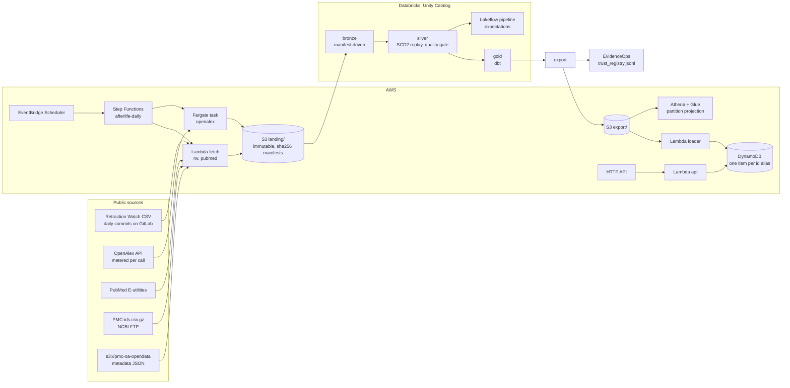

# Architecture

Locally, the same code runs with `data/` standing in for S3, path addressed
Delta tables under `data/lake/` standing in for Unity Catalog, and dbt on
DuckDB and Spark SQL standing in for a Databricks SQL warehouse.

## Layers

| Layer | Where | What | Decision record |
| --- | --- | --- | --- |
| landing | `data/landing`, S3 | raw bytes, sha256 manifests, never rewritten | ADR 0002 |
| bronze | Delta | one table per source, every row with lineage, row counts checked | ADR 0005 |
| silver | Delta | SCD2 history of Retraction Watch on meaning; quarantine; conformed ids | ADR 0003, 0004 |
| gold | dbt | identity resolution, registry, agreement, lag, afterlife citations, reasons, mutability | ADR 0001 |
| export | files | serving documents, Parquet for Athena, EvidenceOps trust records | |
| serving | DynamoDB + Lambda | lookup by DOI, PMID, PMCID, or OpenAlex id | ADR 0001 |

## Identity

A paper appears under different ids in different registries. Gold resolves a
canonical key per paper, `doi:` when any source supplies a DOI, else `pmid:`,
else the source's own id. A PMID is mapped to a DOI through the most trusted
source that pairs them (Retraction Watch, then OpenAlex, then NCBI's PMC id
map). Resolution is one hop, which can split one paper into two rows and so
can only undercount agreement.

## Full coverage PMC, designed, not run

The PMC enrichment fetches metadata only for the PMCIDs other registries
mention. Reading the `is_retracted` flag of every article in the bucket is a
natural Step Functions Distributed Map job: its `ItemReader` reads the
bucket's own daily S3 Inventory manifest (published under
`inventory-reports/` in CSV), fans out to Lambda in batches, and writes one
JSONL part per batch to the landing zone. It has not been built or run.

## What runs where

| Component | Executed locally on real data | Validated statically | Not executed |
| --- | --- | --- | --- |
| fetchers, landing, CLI | yes | | |
| bronze, silver (Spark 3.5, Delta 3.3) | yes | | Databricks runtime |
| dbt gold on DuckDB and Spark SQL | yes | | |
| dbt on Databricks, Snowflake, BigQuery | | `dbt parse` | live warehouse |
| Lambda handlers | moto | | AWS |
| Terraform | | fmt, validate, checkov | apply |
| Databricks bundle and pipeline | unit tests of transforms | YAML structure tests | workspace |
